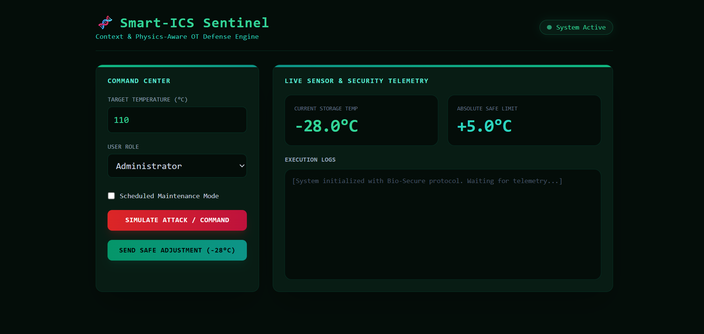
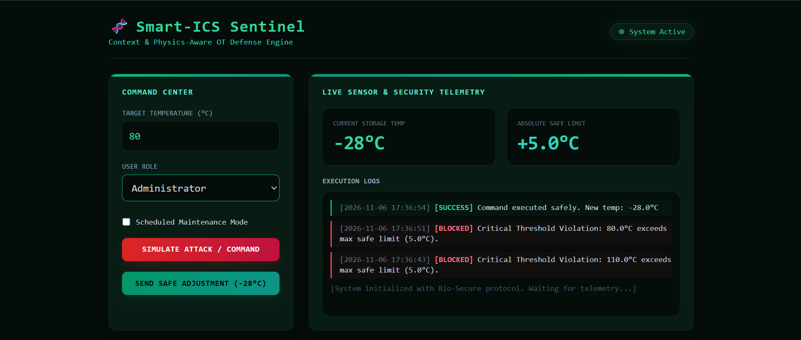

# Smart-ICS Sentinel 🛡️

**Context & Physics-Aware OT Defense Engine**

Smart-ICS Sentinel ek advanced Cyber-Physical Security Proof-of-Concept (PoC) tool hai jo Industrial Control Systems (ICS) aur OT (Operational Technology) environments ko malicious remote manipulations aur cyber-attacks se protect karta hai.

---

## 🖼️ Dashboard Preview & UI Showcase
*Yeh screenshots Smart-ICS Sentinel ke web dashboard ka live execution aur threat blocking interface dikhate hain:*

| Attack Simulation / Critical Block | Successful Safe Adjustment |
| :---: | :---: |
|  |  |

---

## 🔍 Problem Statement & Background
Haal hi me European cold-storage aur blood bank facilities par hue cyber-attacks me attackers ne exposed PLCs (Programmable Logic Controllers) ka access gain karke refrigeration units ka temperature `-30°C` se `110°C` tak badal diya tha, jisse critical biomedical inventory destroy ho gayi thi. 

Traditional EDR, SIEM, aur signature-based tools in attacks ko nahi rok paate kyunki attackers legitimate administrative credentials ya valid API commands ka use karke unauthorized parameters pass karte hain.

---

## ⚡ How It Works (Core Defense Logic)
Smart-ICS Sentinel sirf command signatures par depend nahi کرتا, balki yeh **3-tier verification gateway** use karta hai:

1. **Absolute Thermal Threshold Check:** Yeh check karta hai ki kya requested target temperature biological ya mechanical safety limits (`+5.0°C` ke andar) ke under hai ya nahi. Agar limit cross hoti hai, toh system turant critical block trigger karta hai.
2. **Physics-Aware Rate of Change Engine:** Yeh physical laws enforce karta hai. Jaise, koi bhi cooling system ek second ya minute me extreme temperature jump nahi kar sakta. Agar rate of change permissible limits (`2.0°C/min`) se zyada hai, toh yeh physical anomaly detect karke command rok deta hai.
3. **Contextual Intent & Role Verification:** Yeh operational schedules aur user permissions ko cross-verify karta hai.

---

## 👥 User Roles & Access Control
System me do primary roles define kiye gaye hain:

* **Administrator:** Inke paas core configuration aur maintenance permissions hoti hain. Lekin system ka security architecture yeh ensure karta hai ki agar admin credentials bhi compromise ho jayein, tab bhi koi aisi command execute na ho jo physical safety rules ke khilaf ho.
* **Field Operator:** Inke paas routine monitoring aur standard operational adjustments ke limited access hote hain.

---

## 🌍 Real-World Use Cases
* **Cold-Chain Logistics & Blood Banks:** Vaccine, medicine, aur blood storage units ko remote cyber-sabotage se bachane ke liye jahan thermal fluctuations fatal ho sakti hain.
* **Industrial Cooling & HVAC Infrastructures:** Smart factories aur data centers me cooling controllers ko unauthorized heating/cooling commands se safeguard karne ke liye.
* **Water Treatment Plants:** Chemical dosing aur pump pressure levels par physical-law validation lagane ke liye.

---

## 🚀 Tech Stack & Setup
* **Backend:** Python, Flask
* **Frontend:** Tailwind CSS, HTML5, JavaScript (AJAX)
* **Deployment Ready:** Local development & cloud-ready architecture.

### Quick Start:
1. Clone the repository:
   ```bash
   git clone [https://github.com/00axa/Smart-ICS-Sentinel.git](https://github.com/00axa/Smart-ICS-Sentinel.git)
   cd Smart-ICS-Sentinel

## Install dependencies:
pip install flask

## Run the application:
python app.py
## Open your browser: http://127.0.0.1:5000
